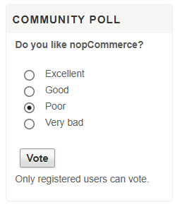

# Hallazgos - Kristel
Requerimientos: RF-01 Registro, RF-02 Inicio/cierre de sesion, RF-11 Boletin y encuesta

Un hallazgo = diferencia entre el requerimiento y el comportamiento real del sitio, o un defecto. Copie el bloque por cada hallazgo.

## H-K01 - (titulo corto)
- **Requerimiento / caso:** RF-11 / CP-014
- **Pasos para reproducir:**
  1. Abrir https://demowebshop.tricentis.com sin iniciar sesion
  2. En el bloque Community poll, seleccionar una opcion (ej. Excellent)
  3. Clic en Vote
- **Resultado esperado (segun requerimiento):** "Se puede votar en la encuesta de la comunidad" (no indica que sea solo para usuarios registrados)."
- **Resultado real (sitio):** Aparece el aviso "Only registered users can vote." y el voto no se registra.
- **Severidad:** Baja
- **Evidencia:** 

