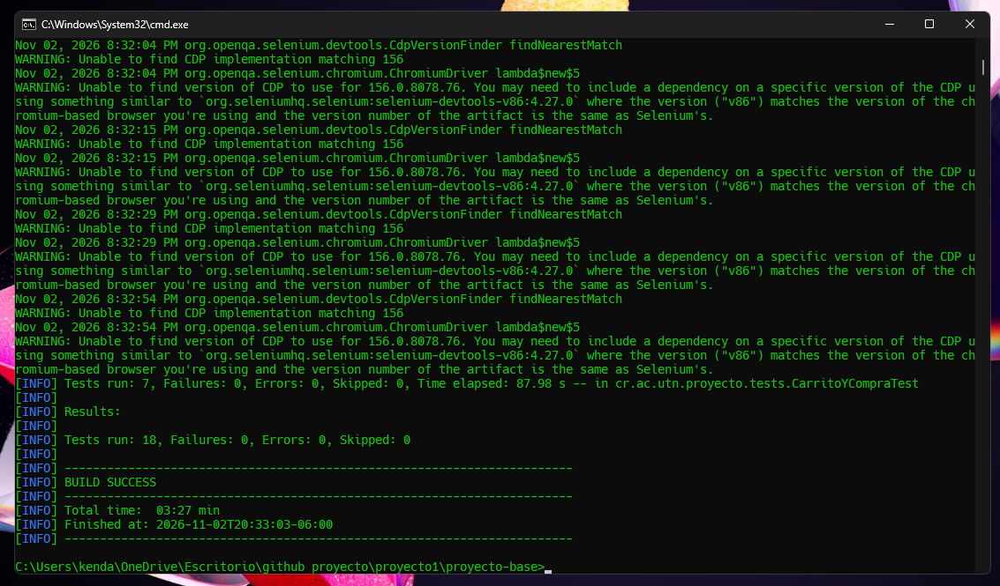

# ISW-622 · Proyecto de automatización · Demo Web Shop

**Grupo:** JAVALovers  
**Integrantes:**
- Juan Pablo Murillo Aragón
- Anthony Martínez Ruiz
- Kendall Gómez Alvarado
- Luis Carlos Jiménez

**Sitio bajo prueba:** https://demowebshop.tricentis.com

## Estructura del proyecto

    src/test/java/cr/ac/utn/proyecto/
    ├── base/   BaseTest (Chrome limpio por prueba) y Visual (pausa solo para observar)
    ├── pages/  HomePage, RegisterPage, LoginPage, SearchPage,
    │           CategoryPage, ProductPage, CartPage y CheckoutPage
    └── tests/  AutenticacionTest, BusquedaYCatalogoTest y CarritoYCompraTest

## Cómo ejecutar el proyecto

Ejecutar desde la carpeta `proyecto-base` (donde se encuentra `pom.xml`):

    mvn test                              # ejecuta todas las pruebas (18 pruebas)
    mvn test -Dtest=AutenticacionTest     # ejecuta una sola clase de prueba
    mvn test -Dritmo=0                    # ejecuta sin pausas visuales
    mvn test -Dheadless=true              # ejecuta sin ventana del navegador

Los reportes de ejecución se generan en `target/surefire-reports/`.

## Evidencia de ejecución

